# The 10-Year Treasury Yield Is Going Crazy — What Does That Mean for You?

An interactive story that explains, in plain language, how the U.S. 10-year Treasury yield can reach a Canadian
university student's wallet and career.

> **Rising interest rates aren't just Wall Street's problem. They can affect your wallet and your career, but not everyone is affected equally.**

**Bohdan Zmeul · Danyal Shenoda · Humzah Ahmed**
CSC316 Data Visualization · University of Toronto · Fall 2026

### ▶ Live site: **https://zmeulboh.github.io/csc316-final-project/**

**Process book:** [Google Doc](https://docs.google.com/document/d/1Sr4uAKbj8h2TRenuFmDX-Hdx7Ws0rbXcnyzvuotItFQ/edit?tab=t.0#heading=h.2xjf980qs23)

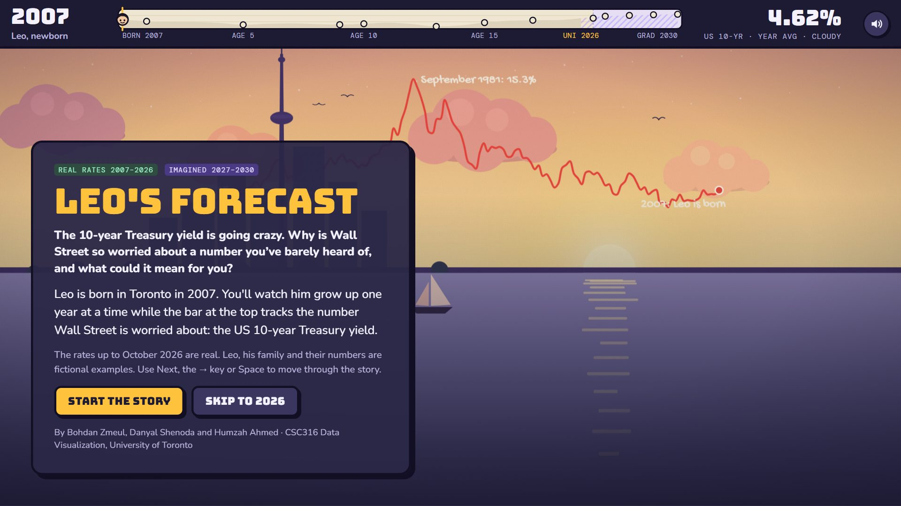

---

## Contents

- [About the project](#about-the-project)
- [Running the code](#running-the-code)
- [Libraries and tools](#libraries-and-tools)
- [Data](#data)
- [Code](#code)
- [Prototype versions](#prototype-versions)
- [Research](#research)

## About the project

The 10-year Treasury yield is one of the most watched numbers in finance, but most students have barely heard of it.
The project answers one question: *"Why is everyone on Wall Street worried about a number I have barely heard of, and
what could it eventually mean for me?"*

**Audience:** Canadian university students with little or no finance background. The story uses familiar forms (line
charts, bars drawn to scale, a slider, a map) and focuses on consequences (rent, mortgages, budgets, jobs) rather
than financial theory.

### Leo's Forecast ([`index.html`](index.html))

A story game. You follow Leo, a Toronto kid born in 2007, one year at a time. The life bar at the top tracks the real
10-year yield (click a chapter's dot to jump there). Every scene is lit by that year's rates (sunny when they are low,
stormy when they are high), and the real yield also appears inside the scenes as a "red thread": a garland, a kite
string, the TV news. Point at it (or tap it) to see which months it shows. The interactive moments:

| Year | Scene | What you do | What it shows (real data) |
|------|-------|-------------|---------------------------|
| 2016 | Grandma's family album | Open the cover, flip the pages, point at Grandpa's graph paper | The monthly 10-year yield since 1962, on the same scale on every page |
| 2020 | Leo's sketchbook | Draw your guess of where rates go next | The yield up to the 2020 record low, then what really happened |
| 2022 | Mom's budget pad | Drag the mortgage renewal rate | A family budget drawn to scale (Canadian 5-year rates) |
| 2024 | Dominoes in the café | Push the first domino | The chain from the 10-year yield to Leo's shifts, each step with its real number |
| 2026 | The CN Tower's binoculars | Drag, zoom, click a neighbourhood | Canadian jobs by industry since February 2022 (rain clouds = more exposed, sun = more sheltered) |
| 2026 | The rate slider | Pick where rates go by 2030 | Four imagined futures (2027–2030), drawn with dashed lines so they never look like data |

<table>
  <tr>
    <td width="50%">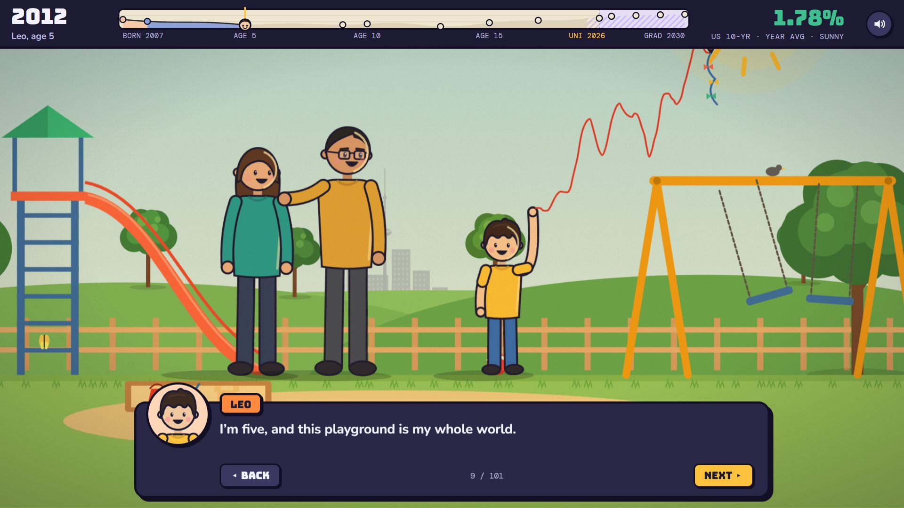<br><b>The red thread.</b> Leo's kite string is the real yield from 2007 to 2012.</td>
    <td width="50%">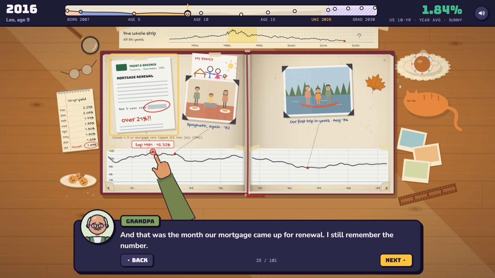<br><b>Grandma's album (2016).</b> Grandpa's graph paper: the yield since 1962, here at the September 1981 record.</td>
  </tr>
  <tr>
    <td>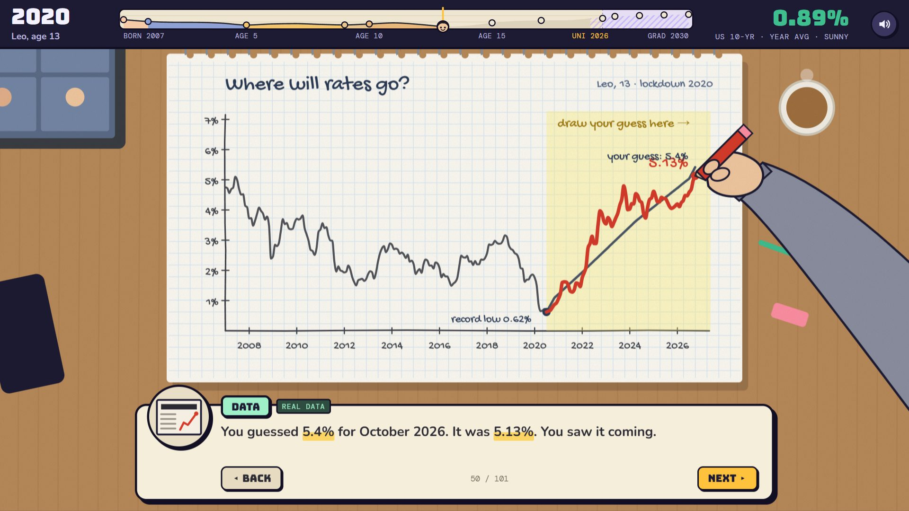<br><b>Leo's sketchbook (2020).</b> Draw your guess, then see what really happened.</td>
    <td>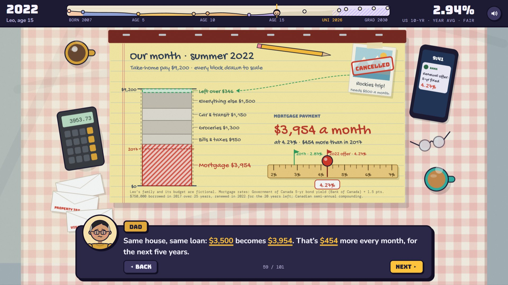<br><b>The budget pad (2022).</b> Drag the renewal rate; every block is drawn to scale.</td>
  </tr>
  <tr>
    <td>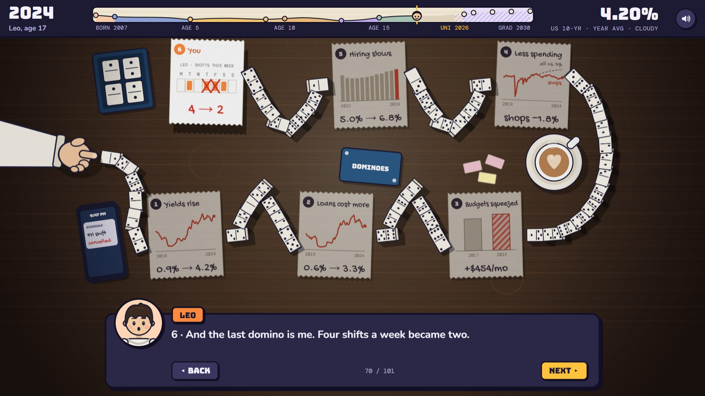<br><b>The dominoes (2024).</b> From higher yields to Leo's shifts, each step with real data.</td>
    <td>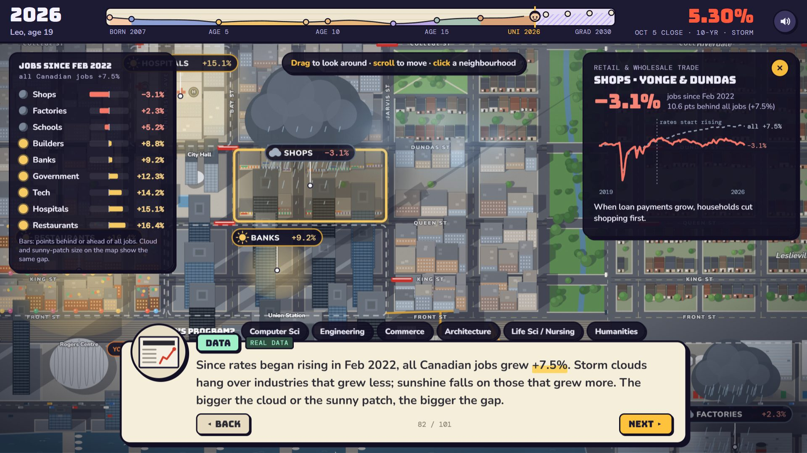<br><b>The CN Tower view (2026).</b> Linked views: ranked list, map and detail card for Canadian jobs by industry.</td>
  </tr>
  <tr>
    <td>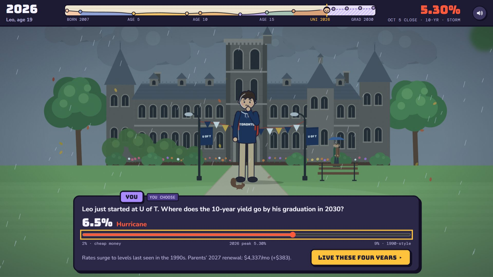<br><b>The rate slider.</b> The campus weather, life bar and rain sound follow your pick.</td>
    <td>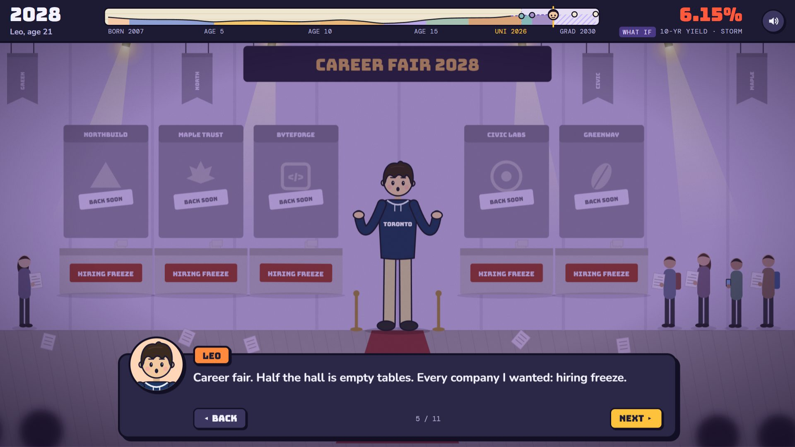<br><b>One possible future (2028).</b> At 6.5%, every booth is under a hiring freeze.</td>
  </tr>
</table>

The story ends on a corkboard: one photo per chapter, each pinned at that year's yield. Below it are the main message
and three things students can do: build a money cushion, time their next step, and know their industry's exposure.

<table>
  <tr>
    <td width="50%">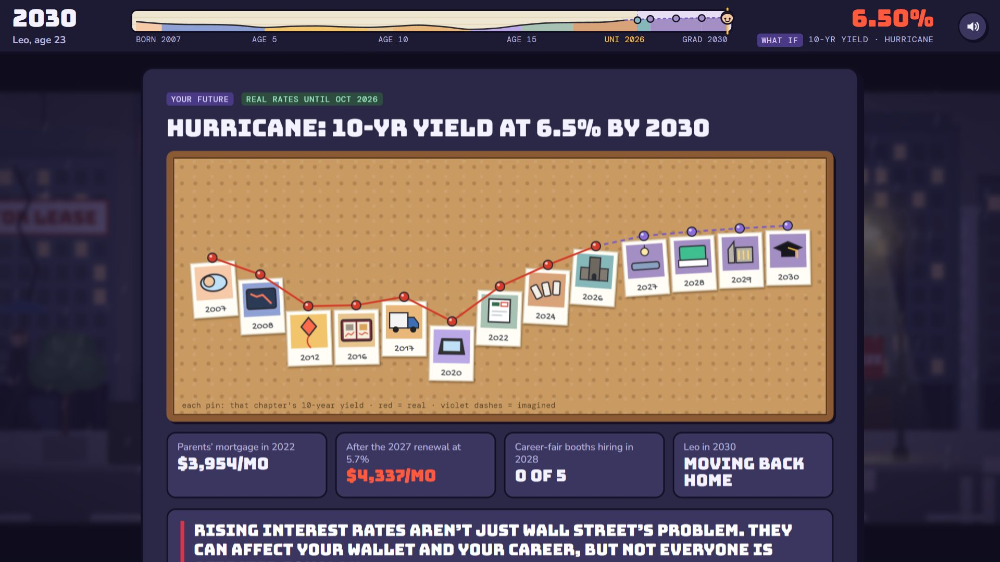<br><b>The end card.</b> Each chapter pinned at its yield: red = real, violet dashes = imagined.</td>
    <td width="50%">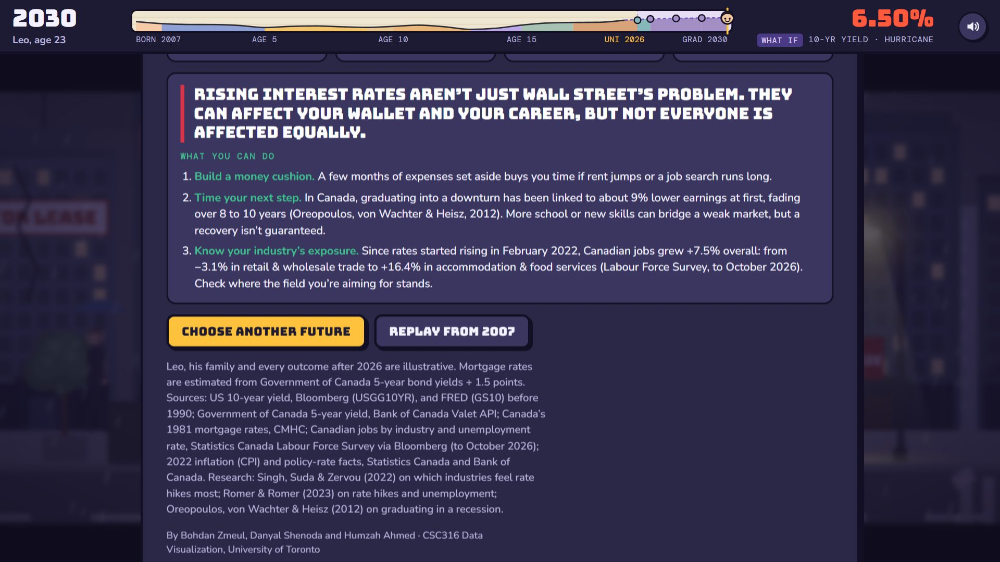<br><b>The main message</b> and what students can do.</td>
  </tr>
</table> Rates are real up to
October 2026. Leo, his family and every outcome after 2026 are fictional examples. Sound is generated in the
browser and can be muted with the speaker button.

### Rate Weather ([`prototype/rate-weather.html`](prototype/rate-weather.html))

Our earlier data prototype, kept as a second page: a scrolling explainer with the yield's history, a domino chain, a
household and business budget with a rate slider, and the job-market "weather" by industry. Open it at
`/prototype/rate-weather.html`.

## Running the code

The site is plain HTML, CSS and JavaScript: no build step and nothing to install. The pages load their data with
`d3.json`, which browsers block for pages opened by double-clicking (`file://`), so serve the folder with any local web
server. Python 3 has one built in:

```bash
git clone https://github.com/zmeulboh/csc316-final-project.git
cd csc316-final-project
python -m http.server 8000
```

Then open **<http://localhost:8000>** (Leo's Forecast) or <http://localhost:8000/prototype/rate-weather.html>. Stop
the server with `Ctrl+C`. An internet connection is needed for D3 and the fonts, which load from CDNs. VS Code's Live
Server extension works too.

**Optional, for development:**

```bash
npm install          # needs Node.js 18+; installs the linters only
npm run lint         # ESLint (JavaScript) and html-validate (HTML); GitHub Actions also runs it on every pull request
```

**Deployment:** GitHub Pages serves the `main` branch as it is, so a merge into `main` updates the live site.

## Libraries and tools

| What | Version | Used for |
|------|---------|----------|
| [D3.js](https://d3js.org/) | 7.8.5 (from cdnjs) | Loading the data (`d3.json`), scales, lines and areas, axes, transitions, pointer handling |
| [Google Fonts](https://fonts.google.com/) | — | Bungee (headings), Gochi Hand (handwriting), Nunito (text), DM Mono (numbers) |
| Web Audio API | built into browsers | The music box, rain and room sounds (generated, no audio files) |
| SVG, CSS animations | built into browsers | All drawings and characters (no image files) |
| Python 3.10+ with `sqlite3` | standard library | The data pipeline in [`scripts/`](scripts/) |
| [openpyxl](https://openpyxl.readthedocs.io/) | see [`scripts/requirements.txt`](scripts/requirements.txt) | Reading the Bloomberg `.xlsx` exports (only to rebuild the database) |
| ESLint 9, html-validate 9 | see [`package.json`](package.json) | Linting (development only) |

Everything else (the characters, scenes, camera, page turns, sound) is our own code.

## Data

All the data is in one SQLite database, [`prototype/data/project.db`](prototype/data/project.db). A script exports
what the pages show into two JSON files. **Every table, series and field is described in
[`prototype/data/README.md`](prototype/data/README.md).**

| Data | Source |
|------|--------|
| U.S. 10-year Treasury yield (daily since 1990; monthly since 1962) | Bloomberg `USGG10YR`; FRED `GS10` before 1990 |
| Government of Canada 5- and 10-year bond yields | Bank of Canada Valet API |
| Canadian jobs by industry (Labour Force Survey) and unemployment rate | Bloomberg (Statistics Canada) |
| U.S. recession months, 30-year mortgage rates | FRED `USREC`, `MORTGAGE30US`; Bloomberg `NMCMFR30` |
| Also stored for analysis: U.S. 2-year yield, U.S. unemployment, S&P 500, U.S. jobs by industry | Bloomberg |

Data runs to early November 2026 (jobs to October 2026). Facts that are not series (Canada's 2022 inflation peak, the
1981 mortgage rate) are cited on the page. The site's sources are listed on its end card.

### Rebuilding the data

The raw Bloomberg exports are not in the repository (the team keeps them in a shared folder). To rebuild:

```bash
pip install -r scripts/requirements.txt
python scripts/build_db.py path/to/xlsx-folder   # Excel exports + Bank of Canada + FRED -> project.db
python scripts/export_data.py                    # project.db -> prototype/data/leo.json and weather.json
```

Don't edit the JSON files by hand: change the queries in `export_data.py` and rerun it. Without the raw exports,
`export_data.py` still works on the database that is already in the repository.

### Exploratory analysis

[`scripts/explore.py`](scripts/explore.py) holds the checks behind the story's claims. Run it with
`python scripts/explore.py`; it needs only the Python standard library. It prints:
1. Data quality: duplicates and missing months.
2. The yield's record high and lows, and the 2026 peak.
3. When the yield curve inverted, and the recessions that followed.
4. How yields and unemployment moved together. The correlation is weak, which is why the story says "can" and never
   "always".
5. Canadian jobs by industry since February 2022.
6. The family's mortgage math.

### Assumptions

- The family's mortgage: $320,000 borrowed in 2007 (a $400,000 townhouse, 20% down) and $750,000 in 2017 for a bigger
  house, both over 25 years with 5-year terms and Canadian semi-annual compounding. The rate for each term is the
  Government of Canada 5-year yield plus 1.5 points.
- The story shows how these numbers have moved *together* and what research finds about the links. It never claims
  that rising yields always cause job losses or recessions.

## Code

```
index.html                 # Leo's Forecast: the whole story game (HTML, CSS and JavaScript in one file)
prototype/
  rate-weather.html        # Rate Weather: the earlier data prototype
  data/
    README.md              # the data dictionary: every table, series and field
    project.db             # SQLite database with all project data
    leo.json               # data for index.html      (written by export_data.py)
    weather.json           # data for rate-weather.html (written by export_data.py)
scripts/
  build_db.py              # raw exports + Bank of Canada + FRED -> project.db
  export_data.py           # project.db -> leo.json and weather.json
  explore.py               # exploratory analysis: the checks behind the story's claims
  requirements.txt         # Python packages for the scripts
.github/workflows/ci.yml   # runs the linters on pull requests and pushes to main
package.json               # lint scripts (ESLint, html-validate)
docs/screenshots/          # the screenshots in this README
docs/v1/, docs/v2/, docs/v3/  # screenshots of each prototype version
CLAUDE.md                  # project context for the AI coding assistant the team used
```

**How `index.html` is organised.** The script starts with a map of its sections, each marked by a
`/* ===== name ===== */` header:
- **The data:** the real numbers from `leo.json`.
- **The story:** every scene as plain data (year, place, light, cast, lines), so the story can be edited without
  touching the drawing code.
- **The scene kit:** one SVG drawing function per place.
- **Presentation:** the characters, camera, page turns, the dialogue box with its small DATA chart, playback, the end
  card, the rate slider and the sound.

Comments explain what each part does and why, including the performance choices, so it runs smoothly on older laptops.

**Honesty rules in the code.**
- Every number on screen is computed from the data files, with its month or date.
- Bars and blocks start at zero and are drawn to scale.
- Imagined futures are always dashed or violet.
- Fictional people and scenarios are labelled as fictional.

## Prototype versions

Each version is a commit in this repository. Its screenshots were taken by running that commit's code, so they show
exactly what it looked like. Each version's full code and data is also in a zip next to its screenshots. To run one, unzip
it (or `git checkout <commit>`), then serve the folder as above. V1's story page is `prototype/leos-forecast.html`.

| Version | Commit | Date | What it had | Screenshots and code |
|---------|--------|------|-------------|----------------------|
| **V1** | [`2c2c9b6`](https://github.com/zmeulboh/csc316-final-project/tree/2c2c9b6126839f5e0e9cfb9ffeeace828bd82b9b) | Nov 8, 2026 | The first story game (`prototype/leos-forecast.html`): Leo's life from 2007 to 2030 in flat scenes, with the life bar and the dialogue. Plus the Rate Weather data page. Data in one JSON file made by `prep.py`. | [`docs/v1/`](docs/v1/) · [code (zip)](docs/v1/leos-forecast-v1-code.zip) |
| **V2** | [`b57b53f`](https://github.com/zmeulboh/csc316-final-project/tree/b57b53fbdf29b73eac07d3f842183c430f5250a3) | Nov 14, 2026 | The SQLite pipeline (`build_db.py`, `export_data.py`). Illustrated, animated scenes. The interactive moments: a roller coaster (2016), the sketchbook (2020), the budget pad (2022), the dominoes (2024), an industry city from the CN Tower (2026), the rate slider with four futures and the corkboard ending. Lint checks on GitHub. | [`docs/v2/`](docs/v2/) · [code (zip)](docs/v2/leos-forecast-v2-code.zip) |
| **V3** | [`b64ac29`](https://github.com/zmeulboh/csc316-final-project/tree/b64ac29fbc26084631a70ce2e0d59c90e8d7d014) | Nov 27, 2026 | A film look: a colour grade per year, camera moves, page turns between years, generated sound. Grandma's album replaces the roller coaster. The CN Tower view becomes a Toronto map linked to a ranked list. The life bar is clickable. The main message, takeaways and authors are on the page. | [`docs/v3/`](docs/v3/) · [code (zip)](docs/v3/leos-forecast-v3-code.zip) |
| **Final** | `main` | | V3 plus this documentation: the README, the data dictionary, the exploratory analysis script and the screenshots above. | [`docs/screenshots/`](docs/screenshots/) |

## Research

The story's explanations draw on:

- Patrabansh, Doerner & Asin (2014). *The Effects of Monetary Policy on Mortgage Rates.* Federal Housing Finance Agency.
- Estrella & Mishkin (1998). *Predicting U.S. Recessions: Financial Variables as Leading Indicators.* Review of Economics and Statistics.
- Oreopoulos, von Wachter & Heisz (2012). *The Short- and Long-Term Career Effects of Graduating in a Recession.* AEJ: Applied Economics.
- Singh, Suda & Zervou (2022). *Monetary Policy, Labor Market, and Sectoral Heterogeneity.* AEA Papers and Proceedings.
- Romer & Romer (2023). *Does Monetary Policy Matter? The Narrative Approach after 35 Years.* American Economic Review.
- Sarikov & Kuprianov (2020). *The Effect of Monetary Policy on Corporate Bankruptcies: Evidence from the United States.* Applied Economics.

The design process (audience, questions, sketches, voting, storyboard, prototypes and the think-aloud test) is
documented in the team's [process book](https://docs.google.com/document/d/1Sr4uAKbj8h2TRenuFmDX-Hdx7Ws0rbXcnyzvuotItFQ/edit?tab=t.0#heading=h.2xjf980qs23).

---

Built for CSC316: Data Visualization, University of Toronto.

